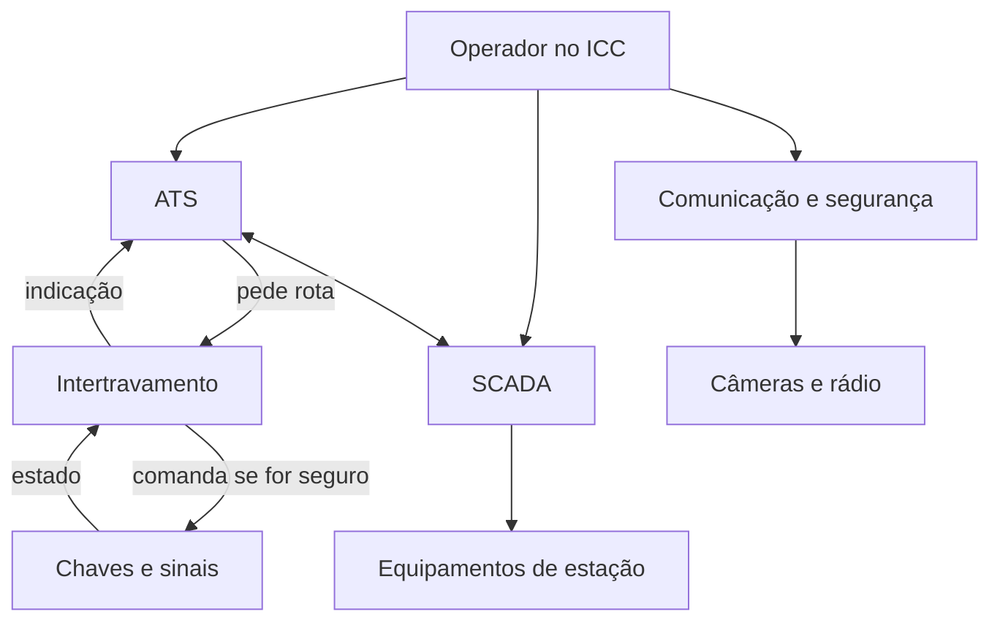

# Lição 01 — O que é um ICC

- **ID da lição:** `lesson_01_icc_visao`
- **Tema:** `topic_icc_visao`
- **Objetivo observável:** desenhar o contexto de um ICC, dizer qual subsistema trata cada função e separar o que é vital do que não é.
- **Pré-requisitos:** nenhum. Esta lição parte do zero.
- **Projeto:** `projects/icc-linha-aurora/`
- **Duração prevista:** 1 a 3 sessões de 90 minutos.
- **Fontes verificadas:** `source_alstom_urbalis_vision`, `source_metro_magazine_icc`, `source_nasem_cbtc`.

Esta teoria é material do tutor. Ler não conta como evidência: a evidência vem do que você fizer na prática.

---

## 1. Teoria

### 1.1 Em uma frase

Um centro de controle integrado junta num só lugar a supervisão dos trens, das estações e da segurança. Assim o operador vê a situação inteira e reage mais rápido. A decisão sobre o que é seguro, porém, continua nos sistemas de campo.

### 1.2 Passo 1 — O problema: um incêndio e quatro telas

Imagine uma linha de metrô em que cada sistema tem a sua própria tela:

| Tela | O que mostra |
|---|---|
| A | Onde estão os trens |
| B | Ventilação, escadas rolantes e energia |
| C | Câmeras |
| Rádio | Fica à parte |

Um alarme de incêndio dispara numa estação. O operador precisa olhar quatro sistemas, juntar as informações de cabeça e agir em cada um, sob pressão. Cada troca de tela custa segundos e abre espaço para erro humano.

Há um segundo problema, menos visível: os sistemas não sabem uns dos outros. O sistema que recebe o alarme não avisa o das câmeras nem o dos trens. Quem faz essa ponte é a memória do operador.

### 1.3 Passo 2 — Um ambiente só, com sistemas que conversam

Agora o mesmo alarme numa linha integrada. O alarme chega e, na mesma tela, aparecem as câmeras daquela área. A ventilação da zona entra em modo de emergência por uma regra configurada, sem depender de o operador lembrar. A tela dos trens já mostra quem está perto daquela estação.

Duas coisas mudaram. O operador vê tudo de um lugar só. E os sistemas trocam dados entre si, então parte da resposta acontece sozinha.

**Agora, o nome técnico.** Esse ambiente é o **ICC** (*Integrated Control Center*, centro de controle integrado). Um executivo da Alstom o descreveu à revista Metro Magazine como "the brain to the transport system" (o cérebro do sistema de transporte). Algumas palavras que acabaram de aparecer:

- **Supervisão:** acompanhar o estado de algo e poder comandá-lo a distância.
- **Equipamento fixo:** tudo o que não anda sobre os trilhos, como ventilação, escadas, energia e portas de plataforma.
- **Integrado:** os sistemas trocam dados entre si, e o operador os usa de um lugar só.

Não confunda o ICC com a sala. A sala de onde se opera a linha é o **CCO** (*Operations Control Center*, centro de controle operacional). O ICC é o sistema integrado usado nessa sala.

### 1.4 Passo 3 — Três famílias de coisas para supervisionar

Num mesmo turno, o operador lida com três tipos de situação:

- o trem 12 está atrasado e o trem de trás vai encostar nele;
- uma escada rolante parou numa estação;
- é preciso ver a câmera de uma plataforma lotada e avisar os passageiros.

Cada situação pertence a uma família diferente, e cada família tem o seu subsistema.

**Agora, os nomes técnicos.** A Alstom divide o seu portfólio de supervisão urbana, o Urbalis Vision, em três módulos, que podem ser vendidos separados ou juntos num só centro. Eles servem de modelo mental para esta formação:

| Subsistema | O que supervisiona | Caso acima |
|---|---|---|
| **ATS** (*Automatic Train Supervision*, supervisão automática dos trens) | A circulação dos trens | O trem atrasado |
| **SCADA** (*Supervisory Control and Data Acquisition*, supervisão e aquisição de dados) | Estações e equipamentos fixos | A escada rolante parada |
| **ISM** (módulo de comunicação e segurança) | Comunicação e segurança do centro | A câmera e o aviso aos passageiros |

A Metro Magazine lista as mesmas famílias: ATS, SCADA, comunicações (rádio e telefonia), segurança (câmeras e controle de acesso) e informação ao passageiro.

### 1.5 Passo 4 — Pedir não é decidir

Siga o trem 12, que ficou mais tempo que o previsto numa estação:

1. O sistema de trens vê o trem parado e compara com o horário planejado.
2. A tela mostra o atraso ao operador, sem que ele precise procurar.
3. O sistema calcula uma correção, como reter por alguns segundos o trem de trás para manter a distância entre os dois.
4. Se algum trem precisar de outro caminho, o sistema **pede** esse caminho.
5. Outro sistema, perto da via, confere as condições e **libera ou recusa**.

O passo 5 é o coração do projeto. Mesmo que o cálculo do passo 3 esteja errado, um pedido inseguro é recusado. O ICC não fala diretamente com chaves e sinais: ele conversa com sistemas que ficam mais perto do campo.

Este desenho mostra a **arquitetura** por dentro: quem pede e quem decide. Ele não é o diagrama de contexto que a prática pede, que olha o ICC de fora (veja a seção 1.12).

**Agora, os nomes técnicos.** Quem decide no passo 5 é o **intertravamento** (*interlocking*): o sistema que só libera chaves e sinais quando as condições garantem que nenhum trem será posto em risco. O caminho pedido é a **rota**. Os passos 1 a 4 são funções do ATS:

- **rastreamento de trens** (*train tracking*): saber onde cada trem está (passo 1);
- **tabela horária** (*timetable*): o plano de horários usado na comparação (passo 1);
- **regulação** (*train regulation*): ajustar a marcha para manter horário ou intervalo (passo 3);
- **intervalo entre trens** (*headway*): o tempo entre dois trens num mesmo ponto, que a regulação protege (passo 3);
- **roteamento automático** (*automatic route setting*): o sistema pede rotas sem o operador (passo 4).

> **Analogia — a mesma lógica que você vê no campo.** Quando uma chave não tem comprovação de posição, o sinal que depende dela não abre, por mais que o pedido de rota tenha saído do centro. O pedido é só um pedido. Quem manda é a lógica que confere a via. O ICC é a ponta de cima dessa mesma cadeia: ele ganha visão e velocidade, mas não ganha o direito de pular a conferência.

### 1.6 Passo 5 — Quando algo falha: para que lado?

Compare dois defeitos de campo:

- **Caso A:** um circuito de via falha e passa a indicar **ocupado** sem haver trem. O sinal de entrada fecha e nenhuma rota é liberada. A linha atrasa, mas nenhum trem entra ali.
- **Caso B:** uma chave indica que está em posição sem que as agulhas tenham completado o curso. O intertravamento acredita na indicação, libera a rota e abre o sinal. O trem pode passar sobre uma agulha entreaberta e descarrilar.

Nos dois casos, um equipamento de segurança falhou. O que separa os dois casos não é **qual** equipamento falhou, e sim **para que lado** ele falhou: o caso A restringiu mais do que devia, e o caso B permitiu o que devia barrar.

Agora pense no ICC inteiro caindo. Nenhum trem bate, porque a decisão continua no intertravamento. Mas o operador perde a visão e o controle da linha, e milhares de passageiros ficam esperando.

**Agora, os nomes técnicos.**

- **Função vital** (*safety-critical / vital function*): a falha dela pode causar acidente. O caso B mostra por quê.
- **À prova de falhas** (*fail-safe*): projetar para que, diante de uma falha, o sistema vá para o estado seguro. O caso A é um defeito que deu certo nesse sentido.
- **Falha do lado seguro** (*right-side failure*): restringe mais do que deveria (caso A).
- **Falha do lado inseguro** (*wrong-side failure*): permite o que deveria ter sido barrado (caso B).
- **Disponibilidade** (*availability*): a capacidade de o sistema estar funcionando quando se precisa dele. É o que se perde no caso A e na queda do ICC.
- **Modo degradado** (*degraded mode*): operar com funções reduzidas, como a linha sem o ICC.

> **Régua para não errar:** a falha restringe mais do que deveria? Então é disponibilidade. A falha permite o que deveria barrar? Então é segurança.
>
> Este é um erro comum, e ele já apareceu nesta formação: classificar a falha pelo sistema que falhou ("um sistema vital falhou, então é falha de segurança"). O caso A mostra que um equipamento vital pode falhar sem causar risco nenhum. O fail-safe existe justamente para transformar falhas de equipamento vital em perda de disponibilidade.

A literatura técnica de CBTC (sinalização baseada em comunicação com o trem, tema da Fase 1) trata o ATS como um conjunto de funções **não vitais**. A segurança dos trens fica no intertravamento e na proteção automática do trem, que veremos na Fase 1. **Não vital não significa sem importância:** a disponibilidade do ICC afeta milhares de pessoas. Além disso, certas funções de emergência, como a ventilação em caso de incêndio, têm requisitos próprios. Se uma função é vital ou não, quem define é a análise de segurança de cada projeto, nunca a intuição.

### 1.7 Exemplo aprofundado: incêndio numa estação

Aqui vários subsistemas trabalham juntos. É o tipo de cenário que justifica a integração, e a Metro Magazine cita algo parecido: um alarme que aciona ventilação e câmeras.

| Passo | Subsistema | O que acontece |
|---|---|---|
| 1 | SCADA | Recebe o alarme do detector da estação |
| 2 | ISM | Mostra as câmeras daquela área ao operador |
| 3 | SCADA | Ativa o modo de ventilação de emergência daquela zona |
| 4 | ATS | Mostra os trens próximos e permite impedir a entrada de outros na estação |
| 5 | ISM | Envia avisos aos passageiros e fala com a equipe por rádio |
| 6 | Intertravamento | Continua garantindo a segurança de cada movimento |

O ganho está nos passos 1 a 3 poderem ser ligados por uma lógica configurada, em vez de dependerem só da memória do operador. O risco vem junto: **quanto mais automação, mais importa testar**. Uma regra errada pode ligar a ventilação da zona errada e empurrar fumaça para onde estão os passageiros. Por isso a formação tem uma fase inteira sobre verificação e validação.

Sprinklers e portas corta-fogo costumam ser acionados localmente, pelo sistema de incêndio da própria estação, que funciona mesmo com o ICC fora do ar. Nesses casos, o ICC supervisiona. O arranjo exato depende do projeto e da norma aplicável, mas a regra geral vale para toda a formação: o que precisa funcionar numa emergência não deve depender só do centro de controle.

### 1.8 Glossário

Para consulta. Cada termo foi apresentado no passo indicado.

| Português | Inglês | Significado | Passo |
|---|---|---|---|
| Centro de controle integrado | *Integrated Control Center (ICC)* | Ambiente único de supervisão de trens, equipamentos e segurança | 1.3 |
| Centro de controle operacional | *Operations Control Center (OCC)* | A sala de onde se opera a linha; o ICC é o sistema usado nela | 1.3 |
| Supervisão | *Supervision* | Acompanhar o estado e poder comandar a distância | 1.3 |
| Equipamento fixo | *Fixed equipment* | O que não anda sobre os trilhos | 1.3 |
| Subsistema | *Subsystem* | Parte de um sistema com função própria | 1.4 |
| Supervisão automática dos trens | *Automatic Train Supervision (ATS)* | Gerencia a circulação | 1.4 |
| Supervisão e aquisição de dados | *SCADA* | Supervisiona estações e equipamentos fixos | 1.4 |
| Intertravamento | *Interlocking* | Decide se chaves e sinais podem atuar com segurança | 1.5 |
| Rota | *Route* | Caminho pedido para um trem | 1.5 |
| Rastreamento de trens | *Train tracking* | Saber onde cada trem está | 1.5 |
| Tabela horária | *Timetable* | Plano de horários | 1.5 |
| Regulação | *Train regulation* | Ajustar a marcha para manter horário ou intervalo | 1.5 |
| Intervalo entre trens | *Headway* | Tempo entre dois trens num mesmo ponto | 1.5 |
| Roteamento automático | *Automatic route setting* | O sistema pede rotas sem o operador | 1.5 |
| Função vital | *Safety-critical / vital function* | A falha dela pode causar acidente | 1.6 |
| À prova de falhas | *Fail-safe* | Falhar para um estado seguro | 1.6 |
| Falha do lado seguro | *Right-side failure* | Restringe mais do que deveria | 1.6 |
| Falha do lado inseguro | *Wrong-side failure* | Permite o que deveria barrar | 1.6 |
| Disponibilidade | *Availability* | Estar funcionando quando se precisa | 1.6 |
| Modo degradado | *Degraded mode* | Operar com funções reduzidas | 1.6 |
| Interface humano-máquina | *Human-Machine Interface (HMI)* | As telas e comandos do operador | 1.12 |
| Diagrama de contexto | *Context diagram* | O sistema como uma caixa e tudo que troca dados com ele | 1.12 |
| Interface | *Interface* | Ponto onde dois sistemas trocam dados | 1.12 |

**Atenção à sigla:** ICC pode vir expandida de outras formas em certos documentos. Confira sempre o significado em cada texto.

### 1.9 Erros comuns e limites

- **"O ICC comanda a chave."** Errado. Ele pede, e o intertravamento decide.
- **"Se o ICC cair, os trens batem."** Errado. Quem protege contra colisão são as funções vitais. A queda do ICC tira visão e controle, e a operação passa para o modo degradado.
- **"Falhou um sistema vital, então é falha de segurança."** Errado. O que importa é o lado da falha (seção 1.6).
- **"Não vital é opcional."** Errado. A disponibilidade do ICC afeta milhares de pessoas.
- **"Integrar tudo sempre é melhor."** Limite real: a integração cria dependências e amplia a superfície de ataque. Cada ligação é uma interface a especificar, testar e proteger.
- **"O ICC é um produto de prateleira."** Limite real: há produtos prontos, mas cada linha exige configuração própria. É a chamada engenharia de aplicação, parte central do trabalho nesta área.
- **Vida útil:** a Metro Magazine, em 2010, citava 10 a 15 anos para sistemas de controle, contra 30 a 40 para o material rodante. Logo, um ICC será trocado várias vezes durante a vida de um trem.
- **Marcas:** Iconis e Urbalis Vision aparecem como nomes de produtos da Alstom. As fontes consultadas não confirmam como um nome se relaciona com o outro hoje. Não afirme isso sem verificar.

### 1.10 Checagens de entendimento

Responda antes de ir para a prática. Isto não vale nota nem é evidência.

1. Com suas palavras, qual problema o ICC resolve?
2. Por que o ATS pode ser não vital se ele lida com a circulação dos trens?
3. Em que uma falha de disponibilidade difere de uma falha de segurança? Dê um exemplo de cada uma, com um equipamento diferente dos casos da seção 1.6.
4. No exemplo do incêndio, o que mudaria se SCADA e ATS não trocassem dados?

### 1.11 Antes de reler

Antes de voltar a esta teoria numa sessão nova, tente lembrar sem olhar: a frase da seção 1.1, os três subsistemas e a régua da seção 1.6. Depois confira.

### 1.12 Ponte para o projeto

No projeto ICC Linha Aurora, você fará o **diagrama de contexto** (*context diagram*), primeira peça do dossiê. Ele olha o ICC **de fora**: o ICC é uma caixa só, e em volta dela ficam todos os sistemas e pessoas que trocam dados com ele. Cada ligação é uma **interface** (*interface*), o ponto onde dois sistemas trocam dados. Uma dessas pessoas é o operador, que usa a **interface humano-máquina** (*HMI*), ou seja, as telas e os comandos. O diagrama define a fronteira do sistema, o que está dentro do ICC e o que está fora, e toda a formação se apoia nesse desenho.

---

## 2. Plano de prática

**Núcleo cognitivo (a parte que precisa ser sua):** decidir a fronteira do ICC, classificar funções e justificar o que é vital.

### Andaimes disponíveis

Usar só se precisar, nesta ordem:

1. Reler a tabela da seção 1.4.
2. Listar primeiro as pessoas e os equipamentos da linha, sem desenhar.
3. Fazer um único subsistema e depois os demais.

### Tarefa independente

Use os dados de `projects/icc-linha-aurora/README.md`. Escreva em `projects/icc-linha-aurora/01-contexto.md`:

1. Um diagrama de contexto, em Mermaid ou à mão (foto no arquivo), com o ICC como caixa central e **todos** os sistemas e pessoas que trocam dados com ele.
2. Uma tabela com **8 funções** da linha, informando subsistema e se é vital ou não, com uma justificativa curta.
3. O caminho do cenário abaixo, passo a passo, como na seção 1.7.

**Cenário:** falta energia de tração em parte da linha, e dois trens param entre estações.

### Erros esperados

- Pôr o intertravamento dentro do ICC.
- Classificar como vital tudo o que parece importante.
- Citar só o ATS no cenário e esquecer os equipamentos de estação e a comunicação com os passageiros.

### Critérios de evidência

- **Feynman:** explicar o ICC a alguém fora da área, sem consultar, cobrindo o problema, os três subsistemas e a diferença entre pedir e decidir.
- **Aplicação padrão:** tarefa completa e correta, sem ajuda além do permitido no Learning Contract.
- **Transferência:** repetir o raciocínio em outro contexto, como um bonde ou uma linha principal.

Quando uma tentativa estiver parcial ou incorreta, antes de qualquer retorno o tutor pede: "Confira sua solução contra cada regra e exemplo da tarefa."

### Atualização do estado

Registrar evidências em `.ai-tutor/state.json`, ligar a sessão à lição, atualizar o domínio só pela matriz e validar o estudo.

---

## 3. Progresso

- **Situação:** em andamento. A teoria está escrita e o tema conta como ensinado. Falta a prática independente.
- **Sessões:** `session_2026-11-02_01` (teoria e checagens em diálogo guiado, concluída) e `session_2026-11-03_01` (interrompida, retomável).
- **Checkpoint:** a tentativa 1 de `projects/icc-linha-aurora/01-contexto.md` tem só a Parte 1 e repete o fluxograma de arquitetura da teoria (seção 1.2 na numeração antiga, hoje seção 1.5). Por isso não conta como evidência autônoma do diagrama de contexto. A autoconferência foi pedida e ainda não foi feita.
- **Evidências:** nenhuma. Domínio 0.
- **Ponto fraco ativo:** `weak_falha_seguranca_vs_disponibilidade`.
- **Próximo passo:** retomar `session_2026-11-03_01`. Começar com uma recuperação curta da teoria, sem consulta. Depois fazer a autoconferência da tentativa 1 e a tentativa 2, com as Partes 1 e 2.
- **Falta:** tarefa independente completa (Partes 1 a 3), Feynman e transferência.
