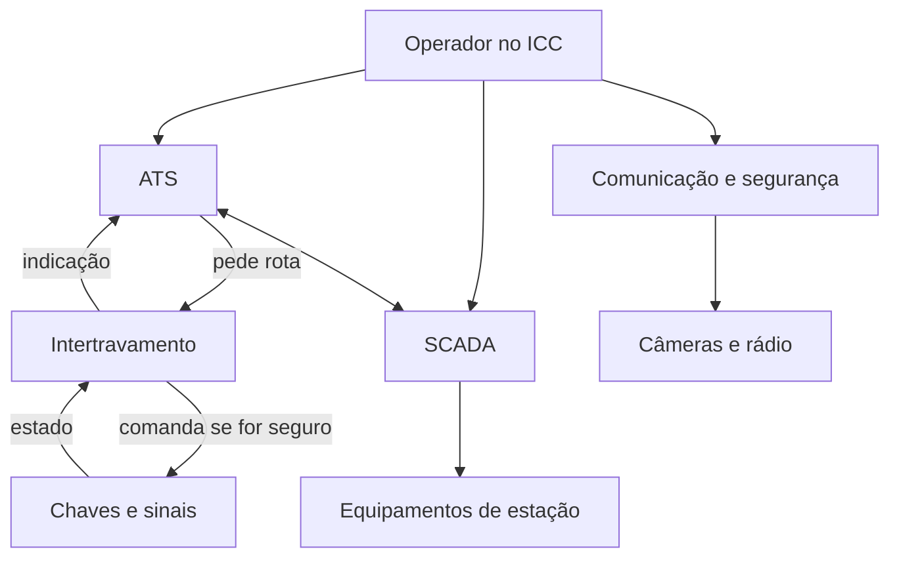

# Lição 01 — O que é um ICC

- **ID da lição:** `lesson_01_icc_visao`
- **Tema:** `topic_icc_visao`
- **Objetivo observável:** desenhar o contexto de um ICC, dizer qual subsistema trata cada função e separar o que é vital do que não é.
- **Pré-requisitos:** nenhum. Esta lição parte do zero.
- **Projeto:** `projects/icc-linha-aurora/`
- **Duração prevista:** 1 a 3 sessões de 90 minutos.
- **Fontes verificadas:** `source_alstom_urbalis_vision`, `source_metro_magazine_icc`, `source_nasem_cbtc`.

Esta teoria é material do tutor. Ler não conta como evidência: a evidência vem do que você fizer na prática.

---

## 1. Teoria

### 1.1 O problema

Imagine uma linha de metrô sem um centro integrado. Uma tela mostra os trens. Outra, em outro sistema, mostra escadas rolantes e ventilação. Uma terceira mostra câmeras, e o rádio fica à parte.

Agora surge um alarme de incêndio numa estação. O operador precisa olhar quatro sistemas, ligar as informações de cabeça e agir em cada um deles, sob pressão. Cada troca de tela custa tempo e abre espaço para erro humano.

O **ICC** (*Integrated Control Center*, centro de controle integrado) existe para resolver isso. Ele reúne num só ambiente a supervisão dos trens, dos equipamentos fixos e da segurança, para que uma pessoa veja a situação inteira e reaja mais depressa. Um executivo da Alstom descreveu o ICC à revista Metro Magazine como "the brain to the transport system" (o cérebro do sistema de transporte).

Algumas palavras-chave desse parágrafo:

- **Supervisão:** acompanhar o estado de algo e poder comandá-lo a distância.
- **Equipamento fixo:** tudo o que não anda sobre os trilhos: ventilação, escadas, energia, portas de plataforma.
- **Integrado:** os sistemas trocam dados entre si, e o operador os usa de um só lugar.

### 1.2 Como funciona

A Alstom divide o seu portfólio de supervisão urbana, o Urbalis Vision, em três módulos, que podem ser vendidos separados ou juntos num só centro. Eles servem de modelo mental para esta formação:

| Subsistema | O que supervisiona | Exemplo |
|---|---|---|
| **ATS** (*Automatic Train Supervision*, supervisão automática dos trens) | A circulação dos trens | Mostrar onde cada trem está, pedir rotas, regular intervalos |
| **SCADA** (*Supervisory Control and Data Acquisition*, supervisão e aquisição de dados) | Estações e equipamentos fixos | Ligar a ventilação, ver o estado de uma escada rolante |
| **ISM** (módulo de comunicação e segurança) | Comunicação e segurança do centro | Câmeras, rádio, informação ao passageiro |

A Metro Magazine lista as mesmas famílias: ATS, SCADA, comunicações (rádio e telefonia), segurança (câmeras e controle de acesso) e informação ao passageiro.

O ICC não fala diretamente com a via. Ele conversa com outros sistemas, que ficam mais perto do campo:

Três ideias sustentam o desenho:

**1. Pedir é diferente de decidir.** O ATS **pede** uma rota. Quem decide se ela é segura é o **intertravamento** (*interlocking*), o sistema que só libera chaves e sinais quando as condições garantem que nenhum trem será posto em risco.

**2. Vital e não vital.** Uma função é **vital** quando a falha dela pode causar um acidente. Por isso ela é projetada para ser **à prova de falhas** (*fail-safe*): se algo der errado, o sistema vai para um estado seguro. A literatura técnica de CBTC trata o ATS como conjunto de funções não vitais. A segurança dos trens fica no intertravamento e na proteção automática do trem, que veremos na Fase 1.

**3. Não vital não significa sem importância.** Perder o ICC não deveria causar colisão, mas pode parar a operação e deixar milhares de passageiros esperando. A falha aqui atinge a **disponibilidade**, que é a capacidade de o sistema estar funcionando quando se precisa dele. Além disso, certas funções de emergência, como a ventilação em caso de incêndio, têm seus próprios requisitos. Se uma função é vital ou não, quem define é a análise de segurança de cada projeto, nunca a intuição.

### 1.3 Vocabulário

| Português | Inglês | Significado |
|---|---|---|
| Centro de controle integrado | *Integrated Control Center (ICC)* | Ambiente único de supervisão de trens, equipamentos e segurança |
| Centro de controle operacional | *Operations Control Center (OCC)* | Sala de onde se opera a linha. O CCO é o lugar; o ICC é o sistema integrado usado nele |
| Supervisão automática dos trens | *Automatic Train Supervision (ATS)* | Gerencia a circulação |
| Rastreamento de trens | *Train tracking* | Saber onde cada trem está |
| Roteamento automático | *Automatic route setting* | O sistema pede rotas sem o operador |
| Regulação | *Train regulation* | Ajustar a marcha para manter horário ou intervalo |
| Intervalo entre trens | *Headway* | Tempo entre dois trens num mesmo ponto |
| Tabela horária | *Timetable* | Plano de horários |
| Intertravamento | *Interlocking* | Decide se chaves e sinais podem atuar com segurança |
| À prova de falhas | *Fail-safe* | Falhar para um estado seguro |
| Função vital | *Safety-critical / vital function* | A falha dela pode causar acidente |
| Disponibilidade | *Availability* | Estar funcionando quando se precisa |
| Modo degradado | *Degraded mode* | Operar com funções reduzidas |
| Interface humano-máquina | *Human-Machine Interface (HMI)* | As telas e comandos do operador |
| Subsistema | *Subsystem* | Parte de um sistema com função própria |
| Diagrama de contexto | *Context diagram* | Desenho do sistema como uma caixa e de tudo que troca dados com ele |
| Interface | *Interface* | Ponto onde dois sistemas trocam dados |

**Atenção à sigla:** ICC pode vir expandida de outras formas em certos documentos. Confira sempre o significado em cada texto.

### 1.4 Exemplo básico: um trem atrasado

Vamos seguir um caso simples, passo a passo.

1. O trem 12 fica mais tempo que o previsto numa estação. **ATS:** o rastreamento mostra o trem parado e compara com a tabela horária.
2. A tela mostra o atraso ao operador. **ICC:** a informação aparece sem que ele precise procurar.
3. O ATS calcula uma correção, como reter por alguns segundos o trem de trás para não encurtar o intervalo. **ATS:** regulação.
4. Se algum trem precisar de outra rota, o ATS a pede. **ATS → intertravamento:** o pedido sai.
5. O intertravamento confere as condições e libera, ou recusa. **Função vital:** a decisão é dele.

Repare no passo 5: mesmo que o ATS erre o cálculo, o pedido inseguro é recusado. Essa separação é o coração do projeto.

### 1.5 Exemplo aprofundado: incêndio numa estação

Aqui vários subsistemas trabalham juntos. Este é o tipo de cenário que justifica a integração, e a Metro Magazine cita algo parecido: um alarme que aciona ventilação e câmeras.

| Passo | Subsistema | O que acontece |
|---|---|---|
| 1 | SCADA | Recebe o alarme do detector da estação |
| 2 | ISM | Mostra as câmeras daquela área ao operador |
| 3 | SCADA | Ativa o modo de ventilação de emergência daquela zona |
| 4 | ATS | Mostra os trens próximos e permite impedir a entrada de outros na estação |
| 5 | ISM | Envia avisos aos passageiros e fala com a equipe por rádio |
| 6 | Intertravamento | Continua garantindo a segurança de cada movimento |

O ganho está nos passos 1 a 3 poderem ser ligados por uma lógica configurada, em vez de dependerem só da memória do operador. O risco aparece junto: **quanto mais automação, mais importa testar**. Uma regra errada pode ligar a ventilação da zona errada. Por isso a formação tem uma fase inteira sobre verificação e validação.

### 1.6 Erros comuns e limites

- **"O ICC comanda a chave."** Errado. Ele pede, e o intertravamento decide.
- **"Se o ICC cair, os trens batem."** Errado. Quem protege contra colisão são as funções vitais. A queda do ICC tira visão e controle, e a operação passa para o modo degradado.
- **"Não vital é opcional."** Errado. A disponibilidade do ICC afeta milhares de pessoas.
- **"Integrar tudo sempre é melhor."** Limite real: a integração cria dependências e amplia a superfície de ataque. Cada ligação é uma interface a especificar, testar e proteger.
- **"O ICC é um produto de prateleira."** Limite real: há produtos prontos, mas cada linha exige configuração própria. É a chamada engenharia de aplicação, parte central do trabalho nesta área.
- **Vida útil:** a Metro Magazine, em 2010, citava 10 a 15 anos para sistemas de controle, contra 30 a 40 para o material rodante. Logo, um ICC será trocado várias vezes durante a vida de um trem.
- **Marcas:** Iconis e Urbalis Vision aparecem como nomes de produtos da Alstom. As fontes consultadas não confirmam como um nome se relaciona com o outro hoje. Não afirme isso sem verificar.

### 1.7 Checagens de entendimento

Responda antes de ir para a prática. Isto não vale nota nem é evidência.

1. Com suas palavras, qual problema o ICC resolve?
2. Por que o ATS pode ser não vital se ele lida com a circulação dos trens?
3. Em que uma falha de disponibilidade difere de uma falha de segurança? Dê um exemplo de cada uma.
4. No exemplo do incêndio, o que mudaria se SCADA e ATS não trocassem dados?

### 1.8 Ponte para o projeto

No projeto ICC Linha Aurora, você fará o **diagrama de contexto**, primeira peça do dossiê. Ele define a fronteira do sistema: o que está dentro do ICC e com o que ele conversa. Toda a formação se apoia nesse desenho.

---

## 2. Plano de prática

**Núcleo cognitivo (a parte que precisa ser sua):** decidir a fronteira do ICC, classificar funções e justificar o que é vital.

### Andaimes disponíveis

Usar só se precisar, nesta ordem:

1. Reler a tabela da seção 1.2.
2. Listar primeiro as pessoas e os equipamentos da linha, sem desenhar.
3. Fazer um único subsistema e depois os demais.

### Tarefa independente

Use os dados de `projects/icc-linha-aurora/README.md`. Escreva em `projects/icc-linha-aurora/01-contexto.md`:

1. Um diagrama de contexto, em Mermaid ou à mão (foto no arquivo), com o ICC como caixa central e **todos** os sistemas e pessoas que trocam dados com ele.
2. Uma tabela com **8 funções** da linha, informando subsistema e se é vital ou não, com uma justificativa curta.
3. O caminho do cenário abaixo, passo a passo, como na seção 1.5.

**Cenário:** falta energia de tração em parte da linha, e dois trens param entre estações.

### Erros esperados

- Pôr o intertravamento dentro do ICC.
- Classificar como vital tudo o que parece importante.
- Citar só o ATS no cenário e esquecer os equipamentos de estação e a comunicação com os passageiros.

### Critérios de evidência

- **Feynman:** explicar o ICC a alguém fora da área, sem consultar, cobrindo o problema, os três subsistemas e a diferença entre pedir e decidir.
- **Aplicação padrão:** tarefa completa e correta, sem ajuda além do permitido no Learning Contract.
- **Transferência:** repetir o raciocínio em outro contexto, como um bonde ou uma linha principal.

Quando uma tentativa estiver parcial ou incorreta, antes de qualquer retorno o tutor pede: "Confira sua solução contra cada regra e exemplo da tarefa."

### Atualização do estado

Registrar evidências em `.ai-tutor/state.json`, ligar a sessão à lição, atualizar o domínio só pela matriz e validar o estudo.

---

## 3. Progresso

- **Situação:** planejada. A teoria está escrita, e nenhuma sessão foi feita.
- **Evidências:** nenhuma.
- **Falta:** leitura com checagens, tarefa independente, Feynman e transferência.
